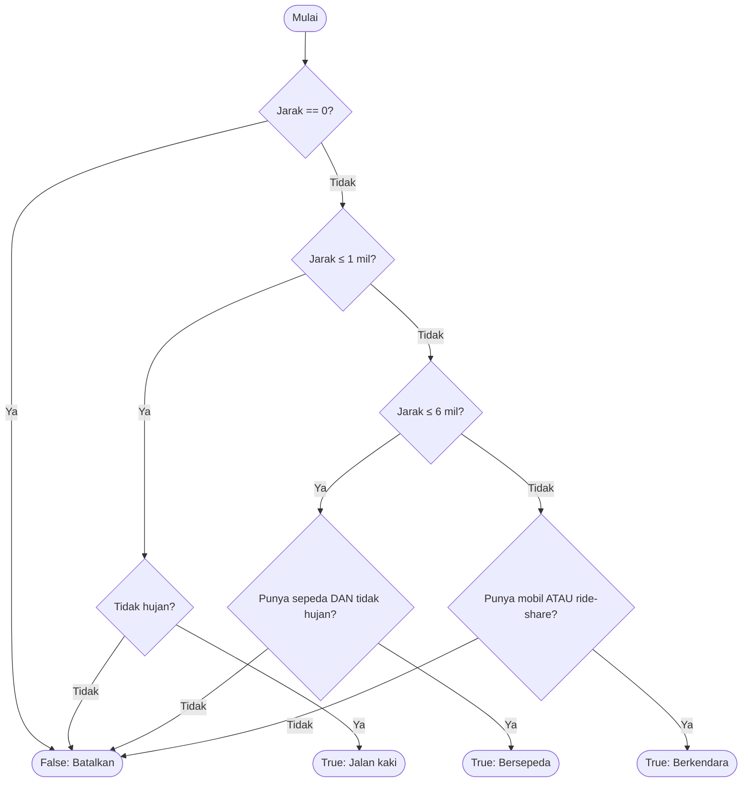

# 🌤️ Travel Weather Planner

### Python Logic & Weather Decision System

> Sistem pengambilan keputusan berbasis logika Python untuk menentukan apakah sebuah perjalanan (*commuting*) memungkinkan berdasarkan **kondisi cuaca**, **jarak tempuh**, dan **ketersediaan kendaraan** — sepeda, mobil, atau aplikasi *ride-share*.

---


---

## 📖 Tentang Proyek

**Travel Weather Planner** adalah proyek latihan logika pemrograman yang berfokus pada penggunaan **percabangan bersyarat** (`if`, `elif`, `else`) serta **operator boolean** (`and`, `or`, `not`) di Python.

Program menerima beberapa variabel input — jarak perjalanan, status hujan, kepemilikan sepeda, mobil, dan aplikasi *ride-share* — lalu mengembalikan keputusan sederhana:

```text
True  → Perjalanan memungkinkan
False → Perjalanan dibatalkan
```

Proyek ini merupakan bagian dari perjalanan belajar **FreeCodeCamp Python Curriculum** dan portofolio logika pemrograman.

---

## ⚙️ Fitur & Aturan Logika (Business Rules)

Seluruh keputusan dihasilkan dari evaluasi berurutan berikut:

| No | Kondisi | Aturan Logika | Hasil |
|:--:|:--------|:--------------|:-----:|
| 1 | Jarak **falsy** (`0` mil) | `not distance_mi` | ❌ `False` |
| 2 | Jarak **≤ 1 mil** | `not is_raining` | ✅ `True` jika tidak hujan |
| 3 | Jarak **1 – 6 mil** | `has_bike and not is_raining` | ✅ `True` jika punya sepeda & tidak hujan |
| 4 | Jarak **> 6 mil** | `has_car or has_ride_share_app` | ✅ `True` jika punya mobil **atau** aplikasi ride-share |

### 🧠 Penjelasan Operator

- **`if` / `elif` / `else`** — mengevaluasi kondisi secara berurutan; blok pertama yang bernilai `True` yang akan dijalankan.
- **`and`** — kedua kondisi harus `True`.
- **`or`** — cukup salah satu kondisi `True`.
- **`not`** — membalik nilai boolean; `not False` menjadi `True`.
- **Falsy value** — nilai seperti `0`, `""`, atau `None` dianggap `False` dalam konteks boolean.

### 🔀 Alur Keputusan



### 🧩 Implementasi Inti

```python
distance_mi = 2
is_raining = False
has_bike = True
has_car = False
has_ride_share_app = True

if not distance_mi:
    print(False)
elif distance_mi <= 1:
    print(not is_raining)
elif distance_mi <= 6:
    print(has_bike and not is_raining)
else:
    print(has_car or has_ride_share_app)
```

---

## 🛠️ Tech Stack

| Teknologi | Fungsi |
|:----------|:-------|
|  | Bahasa pemrograman utama |
|  | Version control |
|  | Code editor |

---

## 🚀 Cara Menjalankan Program (Getting Started)

### Prasyarat

Pastikan **Python 3.x** sudah terpasang di komputer Anda:

```bash
python --version
```

### Langkah-langkah

**1. Kloning repositori** (atau buka folder proyek secara lokal)

```bash
git clone https://github.com/USERNAME/travel-weather-planner.git
cd travel-weather-planner
```

> Ganti `USERNAME` dengan username GitHub Anda. Jika proyek sudah ada di lokal, cukup buka foldernya di VS Code.

**2. Jalankan skrip**

```bash
python main.py
```

> 💡 Di beberapa sistem (Linux/macOS), gunakan `python3 main.py` jika perintah `python` tidak dikenali.

### Contoh Output

Dengan konfigurasi default (`distance_mi = 2`, `has_bike = True`, `is_raining = False`):

```text
True
```

### 🔧 Kustomisasi Skenario

Ubah nilai variabel di bagian atas `main.py` untuk menguji berbagai skenario:

```python
distance_mi = 10          # coba: 0, 1, 3, 10
is_raining = True         # True / False
has_bike = False          # True / False
has_car = True            # True / False
has_ride_share_app = False
```

---

## 📁 Struktur Proyek

```text
Travel Weather Planner/
│
├── main.py        # Logika keputusan utama
└── README.md      # Dokumentasi proyek
```

---

## 👤 Author

<div align="center">

### Chabibulloh Ahmad

**NodeClick** — Web Development & Python Logic Enthusiast

[](https://github.com/)

</div>

---

## 📝 Catatan Portofolio

Proyek ini merupakan bagian dari **portofolio pengembangan web dan skrip logika Python** yang menekankan:

- ✅ Pemahaman **control flow** dan percabangan bersyarat.
- ✅ Penggunaan **operator boolean** dalam pengambilan keputusan.
- ✅ Penerapan **business rules** ke dalam kode yang bersih dan mudah dibaca.
- ✅ Praktik dokumentasi proyek dengan **Markdown** dan **Git**.

> *"Logika yang baik adalah fondasi dari setiap aplikasi yang hebat."*

---

<div align="center">

**⭐ Jika proyek ini bermanfaat, jangan lupa beri bintang! ⭐**

Made with ❤️ by **NodeClick**

</div>
